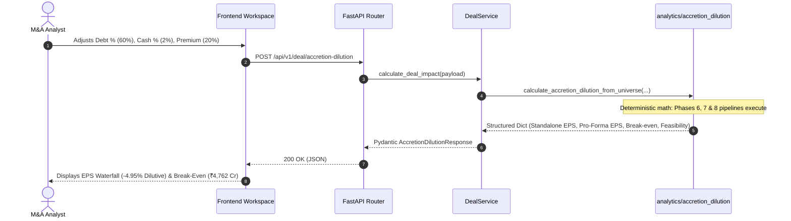
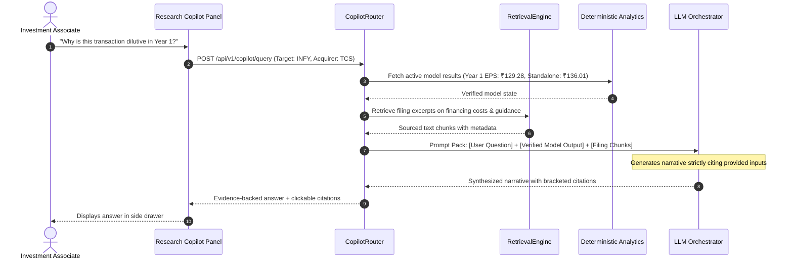

# DealForge — Platform Architecture & Repository Audit

> **Document Type:** System Architecture Blueprint & Repository Audit  
> **Target System:** DealForge — M&A Intelligence & Transaction Modeling Platform  
> **Workspace Root:** `C:\Users\Jignesh\Desktop\dealforge`  
> **Audit Date:** 2026-10-12  
> **Classification:** Technical Reference / Blueprint (Pre-Implementation)  
> **Author:** Senior Software Architect & Implementation Engineer  

---

## 1. Executive Summary

DealForge is an institutional-grade Mergers & Acquisitions (M&A) intelligence and transaction modeling platform tailored specifically for the Indian corporate finance universe.

### Core Architecture Axiom
**The deterministic financial analytics engine is the single source of truth for all financial numbers.** 
Calculations across valuation, financial screening, DCF, comparable companies, precedent transactions, deal structuring, Sources & Uses, and accretion/dilution are strictly deterministic, implemented in pure, audited Python modules, and validated by 172 unit and regression tests. **Under no circumstances will financial calculations be reimplemented in frontend client logic, approximated by an LLM, or replaced by generative artificial intelligence.**

### Dual Intelligence Architecture
DealForge integrates two distinct, tightly decoupled subsystems:
1. **Deterministic Financial Analytics Subsystem (Phases 1–8 Implemented; Phase 9 Proposed):** High-precision mathematical and corporate-finance pipelines that execute structured deal logic, valuation ranges, pro-forma balance sheets, cash reconciliation, and EPS dilution math.
2. **AI & RAG Research Intelligence Subsystem (Proposed):** An institutional evidence retrieval and narrative generation layer that queries structured model outputs, regulatory filings (NSE/BSE, annual reports, MCA filings), transaction press releases, and methodology documentation to synthesize qualitative insights, explain valuation divergences, answer deal-structuring questions, and assist in Investment Committee (IC) memorandum generation. The AI layer consumes deterministic outputs via controlled application interfaces; it never calculates standalone financial metrics independently.

### Current Implementation State Summary
- **Financial Analytics Engine (Phases 1–8):** **CURRENT / ALREADY IMPLEMENTED** (10 modules in `analytics/`, 172 tests passing in `tests/`).
- **Data Repository:** **CURRENT / ALREADY IMPLEMENTED** (113 company profiles, 1,112 annual company-year rows, 4 seed transactions, 113 Screener.in raw files).
- **Backend API Layer:** **NOT YET IMPLEMENTED** (`backend/` directory is completely empty; FastAPI and Pydantic declared in `requirements.txt`).
- **Frontend Application:** **NOT YET IMPLEMENTED** (No frontend directory exists; authoritative visual design established in `DESIGN_SYSTEM.md.md` and `DealForge home page.html`).
- **AI & RAG Subsystem:** **NOT YET IMPLEMENTED** (No vector database, embedding pipeline, or LLM agent code exists).
- **Phase 9 (Scenarios & Sensitivity Analysis):** **NOT YET IMPLEMENTED** (Specification formalized in `DESIGN_SYSTEM.md.md` Section 6).

---

## 2. Actual Current Repository Structure

Direct inspection of `C:\Users\Jignesh\Desktop\dealforge` confirms the exact filesystem state:

```
dealforge/
│
├── analytics/                      <- Pure deterministic financial computation engine
│   ├── __init__.py                 <- Package marker
│   ├── screener_import.py          <- Phase 1: Excel parser & dataset generator (12.7 KB)
│   ├── screening.py                <- Phase 2: Multi-factor screening & ranking (8.9 KB)
│   ├── comps.py                    <- Phase 3: Comparable companies multiples & valuation (8.1 KB)
│   ├── precedents.py               <- Phase 4: Precedent transactions analysis (7.3 KB)
│   ├── dcf.py                      <- Phase 4.5: Discounted Cash Flow engine (12.7 KB)
│   ├── valuation.py                <- Phase 5: Valuation summary & football field (27.6 KB)
│   ├── deal_model.py               <- Phase 6: Deal Builder & consideration structuring (23.5 KB)
│   ├── sources_uses.py             <- Phase 7: Sources & Uses schedule & cash reconciliation (30.7 KB)
│   └── accretion_dilution.py       <- Phase 8: 3-Year Accretion/Dilution & break-even synergies (31.9 KB)
│
├── backend/                        <- CURRENT STATE: EMPTY DIRECTORY (0 files)
│
├── data/                           <- Static analytical datasets (CSV & raw Excel)
│   ├── companies.csv               <- 113 companies (identity, current price, market cap) (7.7 KB)
│   ├── financials.csv              <- 1,112 company-year rows (10-yr history, 2013-2026) (181.5 KB)
│   ├── screening_results.csv       <- Pre-calculated screening metrics for 102 industrial cos (41.3 KB)
│   ├── sector_mapping.csv          <- 113 rows: sector, industry, industrial vs financial classification (9.0 KB)
│   ├── transactions.csv            <- 4 seed precedent M&A transactions (1.7 KB)
│   └── raw/                        <- 113 source Screener.in Excel files (~34 KB each) + 4 lock files
│
├── docs/                           <- Technical and schema documentation
│   └── data-dictionary.md          <- Field definitions, P&L derivations, and quality invariants (4.3 KB)
│
├── tests/                          <- Pytest test suite (172 unit & regression tests)
│   ├── __pycache__/
│   ├── conftest.py                 <- Shared fixtures, root sys.path injector (1.9 KB)
│   ├── test_screener_import.py     <- 11 tests for Phase 1 parser & debt handling (9.5 KB)
│   ├── test_screening.py           <- 9 tests for Phase 2 screening & scoring (7.5 KB)
│   ├── test_comps.py               <- 8 tests for Phase 3 comparable companies (6.3 KB)
│   ├── test_precedents.py          <- 8 tests for Phase 4 precedent transactions (6.3 KB)
│   ├── test_dcf.py                 <- 10 tests for Phase 4.5 DCF valuation (6.9 KB)
│   ├── test_valuation.py           <- 39 tests for Phase 5 Valuation Summary (30.2 KB)
│   ├── test_deal_model.py          <- 27 tests for Phase 6 Deal Builder (17.9 KB)
│   ├── test_sources_uses.py        <- 23 tests for Phase 7 Sources & Uses (18.7 KB)
│   └── test_accretion_dilution.py  <- 37 tests for Phase 8 Accretion/Dilution & feasibility (33.4 KB)
│
├── .venv/                          <- Python 3.14.6 virtual environment
├── .gitignore                      <- Git ignore configuration
├── DESIGN_SYSTEM.md.md             <- Authoritative UI/UX Design System Specification (v2) (54.7 KB)
├── DealForge home page.html        <- Reference implementation bundle of locked public home page (565.3 KB)
├── PROJECT_AUDIT.md                <- Historical audit log covering Phases 1–8 (46.8 KB)
├── README.md                       <- Project overview & quickstart (2.4 KB)
└── requirements.txt                <- Core Python dependencies (93 bytes)
```

---

## 3. Actual Current Phase 1–8 Architecture Audit

Every module in `analytics/` was directly audited. The financial logic is self-contained, deterministic, and free of circular imports or API framework couplings.

```
                    ┌─────────────────────────┐
                    │  Phase 1: Data Parsing  │ (screener_import.py)
                    │  113 Raw Excel Files    │
                    └────────────┬────────────┘
                                 │ Generates companies.csv & financials.csv
                                 ▼
                    ┌─────────────────────────┐
                    │ Phase 2: Target Screen  │ (screening.py)
                    │ Multi-factor Filtering  │
                    └────────────┬────────────┘
                                 │
         ┌───────────────────────┼───────────────────────┐
         ▼                       ▼                       ▼
┌──────────────────┐    ┌──────────────────┐    ┌──────────────────┐
│  Phase 3: Comps  │    │Phase 4: Precedent│    │  Phase 4.5: DCF  │
│    (comps.py)    │    │ (precedents.py)  │    │     (dcf.py)     │
└────────┬─────────┘    └────────┬─────────┘    └────────┬─────────┘
         │                       │                       │
         └───────────────────────┼───────────────────────┘
                                 ▼
                    ┌─────────────────────────┐
                    │ Phase 5: Valuation Sum  │ (valuation.py)
                    │ Football Field Range    │
                    └────────────┬────────────┘
                                 │ Target Pricing & Capacity
                                 ▼
                    ┌─────────────────────────┐
                    │  Phase 6: Deal Builder  │ (deal_model.py)
                    │ Acquirer/Target Struct. │
                    └────────────┬────────────┘
                                 │ Transaction Structure
                                 ▼
                    ┌─────────────────────────┐
                    │Phase 7: Sources & Uses  │ (sources_uses.py)
                    │ Cash Reality & Balance  │
                    └────────────┬────────────┘
                                 │ Executable Capital & Fees
                                 ▼
                    ┌─────────────────────────┐
                    │ Phase 8: Accretion/Dil. │ (accretion_dilution.py)
                    │ 3-Year Pro-Forma EPS    │
                    └─────────────────────────┘
```

### Module 1: `analytics/screener_import.py` (Phase 1 — Data Parsing)
- **Status:** **CURRENT / ALREADY IMPLEMENTED**
- **Purpose:** Ingests raw `.xlsx` files from Screener.in, extracts semi-structured P&L, Balance Sheet, and Cash Flow tables using label-anchored scanning, normalizes unit scales, derives EBITDA and net debt, and exports linked relational CSVs.
- **Main Public Functions/Classes:**
  - `ParsedCompany` (dataclass)
  - `parse_excel_file(path: Path) -> ParsedCompany`
  - `parse_folder(folder: Path) -> tuple[pd.DataFrame, pd.DataFrame]`
  - `report_warnings(warnings: list[str]) -> None`
- **Inputs:** Folder containing raw `.xlsx` files (`data/raw/`).
- **Outputs:** `data/companies.csv` (113 rows) and `data/financials.csv` (1,112 rows).
- **Core Formula:** $\text{EBITDA} = \text{PBT} - \text{Other Income} + \text{Depreciation} + \text{Interest}$. Works backward from PBT to avoid sector-specific line-item discrepancies.
- **Dependencies:** `pandas`, `openpyxl`.
- **CLI Interface:** `python analytics/screener_import.py [raw_folder] [output_folder]`.
- **Test File:** `tests/test_screener_import.py` (11 tests).
- **API Exposure Readiness:** High. Suitable for admin/pipeline endpoints, data ingestion triggers, or file-upload parsing services.
- **Key Warnings & Invariants:**
  - When `Borrowings` is NaN, `net_debt_derived` is strictly set to `NaN` (not zero).
  - Temporary Excel lock files (`~$*.xlsx`) are automatically bypassed.
  - Derived EBITDA is valid for Industrial companies only; Financial sector institutions require separate metrics.

### Module 2: `analytics/screening.py` (Phase 2 — Target Screening)
- **Status:** **CURRENT / ALREADY IMPLEMENTED**
- **Purpose:** Collapses long-format multi-year financials into current valuation, leverage, growth, and profitability metrics; filters the corporate universe by multiple thresholds; computes percentile ranking scores.
- **Main Public Functions:**
  - `compute_metrics(financials_df, companies_df, sector_df) -> pd.DataFrame`
  - `screen(df, min_revenue_cagr, min_ebitda_margin, max_ev_ebitda, max_net_debt_ebitda, sector, industrial_only) -> pd.DataFrame`
  - `add_screening_score(df) -> pd.DataFrame`
- **Inputs:** `companies.csv`, `financials.csv`, `sector_mapping.csv`.
- **Outputs:** Processed dataframe of 102 Industrial companies with screening subscores and composite `illustrative_screening_score` (0–100).
- **Dependencies:** `pandas`, `numpy`.
- **CLI Interface:** `python analytics/screening.py [data_dir]`.
- **Test File:** `tests/test_screening.py` (9 tests).
- **API Exposure Readiness:** Excellent. Direct candidate for `POST /api/v1/screening/run` and `GET /api/v1/screening/universe`.
- **Key Warnings & Invariants:**
  - Financial sector companies (11 banks/NBFCs) are flagged and excluded from Industrial screens.
  - Missing latest-year shares fall back to the most recent preceding year, with `shares_outstanding_is_stale` flagged.

### Module 3: `analytics/comps.py` (Phase 3 — Comparable Companies)
- **Status:** **CURRENT / ALREADY IMPLEMENTED**
- **Purpose:** Identifies industry-matched trading peers, calculates distribution percentiles (25th, Median, 75th) for valuation multiples (EV/Revenue, EV/EBITDA, P/E), and establishes implied enterprise and equity values.
- **Main Public Functions:**
  - `get_peer_group(metrics_df, target_company_id, sector, peer_ids) -> pd.DataFrame`
  - `peer_statistics(peer_df) -> dict`
  - `implied_valuation(target_row, stats, percentile) -> dict`
  - `comps_summary(metrics_df, target_company_id, sector, peer_ids, percentile) -> dict`
- **Inputs:** Metrics dataframe and target identifier, with optional peer overrides.
- **Outputs:** Dictionary containing peer list, peer count, small sample flag, multiples distribution, and implied valuations.
- **Dependencies:** `pandas`.
- **CLI Interface:** `python analytics/comps.py [data_dir] [target_company_id] [--sector S] [--peers P1,P2]`.
- **Test File:** `tests/test_comps.py` (8 tests).
- **API Exposure Readiness:** Excellent. Direct candidate for `POST /api/v1/comps/analyze`.
- **Key Warnings & Invariants:**
  - Peers are matched by narrow sub-industry by default (e.g., Cement, not broad Materials).
  - If peer count < 5, `small_sample_warning` is activated.
  - EV multiples bridge to Equity Value via target net debt ($\text{Equity Value} = \text{EV} - \text{Net Debt}$); P/E applies directly to target net profit.

### Module 4: `analytics/precedents.py` (Phase 4 — Precedent Transactions)
- **Status:** **CURRENT / ALREADY IMPLEMENTED**
- **Purpose:** Ingests M&A transaction history, scales partial-stake transactions to an implied 100% Enterprise Value basis, calculates deal multiple percentiles, and applies them to target financials.
- **Main Public Functions:**
  - `load_transactions(path) -> pd.DataFrame`
  - `filter_transactions(df, sector, industry, min_date, max_date, min_deal_size, max_deal_size) -> pd.DataFrame`
  - `transaction_statistics(df) -> dict`
  - `implied_valuation_from_precedents(target_revenue, target_ebitda, target_net_debt, stats, percentile) -> dict`
- **Inputs:** `data/transactions.csv` (4 seed deals).
- **Outputs:** Filtered deal statistics and implied target valuation.
- **Dependencies:** `pandas`.
- **CLI Interface:** `python analytics/precedents.py [data_dir] [sector]`.
- **Test File:** `tests/test_precedents.py` (8 tests).
- **API Exposure Readiness:** Excellent. Direct candidate for `GET /api/v1/precedents` and `POST /api/v1/precedents/analyze`.
- **Key Warnings & Invariants:**
  - Implied 100% EV scaling: $\text{Implied EV} = \frac{\text{Deal Value}}{\text{Stake \%} / 100}$.
  - Target EBITDA is missing across all seed transactions; EV/EBITDA is universally unavailable.
  - Seed dataset contains 4 deals, triggering `small_sample_warning` on all calls.

### Module 5: `analytics/dcf.py` (Phase 4.5 — Discounted Cash Flow)
- **Status:** **CURRENT / ALREADY IMPLEMENTED**
- **Purpose:** Full 5-year explicit Free Cash Flow to Firm (FCFF) forecasting and Gordon Growth Model terminal value engine with CAPM WACC computation.
- **Main Public Functions:**
  - `compute_wacc(risk_free_rate, equity_risk_premium, beta, cost_of_debt, tax_rate, debt_to_equity) -> float`
  - `project_fcff(latest_revenue, revenue_growth, ebitda_margin, da_pct, capex_pct, tax_rate, forecast_years) -> pd.DataFrame`
  - `terminal_value(final_fcff, terminal_growth_rate, wacc) -> float`
  - `discount_to_present(fcff_series, terminal_value, wacc) -> tuple[float, float, float]`
  - `dcf_valuation(...) -> dict`
- **Inputs:** Baseline financials, operating parameters, and cost of capital parameters.
- **Outputs:** Explicit annual forecast table, present value of explicit cash flows, present value of terminal value, enterprise value, equity value, and implied price per share.
- **Dependencies:** `pandas`, `numpy`.
- **CLI Interface:** `python analytics/dcf.py [data_dir] [company_id] [overrides]`.
- **Test File:** `tests/test_dcf.py` (10 tests).
- **API Exposure Readiness:** Excellent. Direct candidate for `POST /api/v1/valuation/dcf`.
- **Key Warnings & Invariants:**
  - Requires $g < \text{WACC}$; raises ValueError otherwise.
  - CapEx is proxied via $-\text{CFI}$; flags a sanity warning if CapEx % > EBITDA margin (e.g., acquisitive conglomerates like Adani Enterprises).

### Module 6: `analytics/valuation.py` (Phase 5 — Valuation Summary)
- **Status:** **CURRENT / ALREADY IMPLEMENTED**
- **Purpose:** Top-level valuation orchestrator synthesizing Comps, Precedents, and DCF into an institutional football-field valuation table.
- **Main Public Functions:**
  - `valuation_summary(target_id, metrics_df, transactions_df, financials_df, peer_ids, comps_percentile, sector, precedents_percentile, dcf_params) -> dict`
- **Inputs:** Target identifier and analytical datasets.
- **Outputs:** Unified dictionary containing target summary, Comps section, Precedents section, DCF section, football field table (Low, Mid, High), and consolidated data-quality warnings.
- **Dependencies:** `comps.py`, `precedents.py`, `dcf.py`, `pandas`.
- **CLI Interface:** `python analytics/valuation.py [data_dir] [target_id]`.
- **Test File:** `tests/test_valuation.py` (39 tests).
- **API Exposure Readiness:** Prime candidate for `POST /api/v1/valuation/summary`.
- **Key Warnings & Invariants:**
  - **Does NOT blend or average methodologies.** Preserves ranges and reports structural divergence.
  - Aggregates and consolidates all underlying warnings into a single top-level list.

### Module 7: `analytics/deal_model.py` (Phase 6 — Deal Builder)
- **Status:** **CURRENT / ALREADY IMPLEMENTED**
- **Purpose:** Constructs acquisition transaction terms between an Acquirer and a Target, pricing consideration, enforcing financing mix rules, and generating a 3-year synergy ramp.
- **Main Public Functions:**
  - `extract_company_profile(company_id, metrics_df, financials_df) -> dict`
  - `build_deal(acquirer, target, purchase_equity_value, acquisition_premium, cash_pct, debt_pct, stock_pct, transaction_fees, expected_annual_synergies, ...) -> dict`
  - `build_deal_from_universe(...) -> dict`
- **Inputs:** Acquirer profile, target profile, pricing inputs, financing split, synergy schedule.
- **Outputs:** Standardized Deal contract dictionary with sections: `acquirer`, `target`, `transaction`, `financing`, `synergies`, `warnings`.
- **Dependencies:** `pandas`.
- **CLI Interface:** `python analytics/deal_model.py [acquirer] [target] [options]`.
- **Test File:** `tests/test_deal_model.py` (27 tests).
- **API Exposure Readiness:** Excellent. Foundation for `POST /api/v1/deal/build`.
- **Key Warnings & Invariants:**
  - Financing mix percentages must sum to 100% ($\pm 0.01\%$) and fall between 0.0 and 1.0.
  - TEV is calculated only when net debt is known ($\text{TEV} = \text{Purchase Equity} + \text{Net Debt}$). Missing debt is never assumed to be zero.
  - Flags warning if required cash exceeds acquirer standalone cash balance.

### Module 8: `analytics/sources_uses.py` (Phase 7 — Sources & Uses)
- **Status:** **CURRENT / ALREADY IMPLEMENTED**
- **Purpose:** Formulates the funding ledger (Uses vs Sources) and performs strict pro-forma cash and liquidity reconciliation.
- **Main Public Functions:**
  - `calculate_financing_fees(new_debt: float, fee_pct: float) -> float`
  - `reconcile_pro_forma_cash(...) -> dict`
  - `build_sources_and_uses(deal: dict, refinance_target_debt, use_target_cash, debt_issuance_fee_pct, minimum_cash_balance, other_sources, other_uses) -> dict`
  - `build_sources_and_uses_from_universe(...) -> dict`
- **Inputs:** Deal structure dictionary from Phase 6 and funding parameters.
- **Outputs:** Comprehensive ledger with Uses, Requested Sources, Executable Sources, Pro-Forma Cash Reconciliation, and Feasibility Status.
- **Dependencies:** `deal_model.py`, `pandas`.
- **CLI Interface:** `python analytics/sources_uses.py [acquirer] [target] [options]`.
- **Test File:** `tests/test_sources_uses.py` (23 tests).
- **API Exposure Readiness:** Excellent. Core engine for `POST /api/v1/deal/sources-uses`.
- **Key Warnings & Invariants:**
  - **Accounting balance identity:** Total Requested Sources == Total Uses (difference $< 10^{-4}$).
  - **Target Cash Sweep:** Reduces net external funding requirement; never introduces an unexplained plug.
  - **Feasibility Enforced:** If requested cash > available acquirer cash, cash contribution is capped at available balance, pro-forma cash is set to ₹0.0 (never negative), and the deal is marked `is_feasible = False` with the exact deficit stated.

### Module 9: `analytics/accretion_dilution.py` (Phase 8 — Accretion / Dilution)
- **Status:** **CURRENT / ALREADY IMPLEMENTED**
- **Purpose:** Computes 3-year pro-forma EPS accretion/dilution impact on buyer shares, shares issued, new debt interest, foregone cash interest, and exact break-even gross synergy.
- **Main Public Functions:**
  - `calculate_standalone_eps(net_income, shares) -> float | None`
  - `calculate_new_shares_issued(stock_consideration, buyer_share_price, buyer_shares_is_raw) -> float | None`
  - `calculate_break_even_synergies(buyer_standalone_eps, pro_forma_shares, buyer_ni, target_ni, after_tax_debt_interest, after_tax_foregone_interest, tax_rate) -> dict`
  - `calculate_accretion_dilution(buyer, target, deal, sources_uses, debt_interest_rate, foregone_cash_interest_rate, tax_rate, ...) -> dict`
  - `calculate_accretion_dilution_from_universe(...) -> dict`
- **Inputs:** Phase 6 Deal, Phase 7 Sources & Uses, financing rates, and synergy schedule.
- **Outputs:** 3-year EPS waterfall, accretion/dilution ₹ and %, gross and after-tax break-even synergies, and feasibility classification.
- **Dependencies:** `deal_model.py`, `sources_uses.py`, `pandas`.
- **CLI Interface:** `python analytics/accretion_dilution.py [acquirer] [target] [options]`.
- **Test File:** `tests/test_accretion_dilution.py` (37 tests).
- **API Exposure Readiness:** Excellent. Foundation for `POST /api/v1/deal/accretion-dilution` and Phase 9 Scenarios.
- **Key Warnings & Invariants:**
  - Share issuance converts via **Buyer share price only** ($\text{New Shares} = \frac{\text{Stock Consideration}}{\text{Buyer Share Price}}$).
  - Analytical break-even derivation:
    $$\text{Break-Even Gross Synergy} = \frac{\text{Standalone EPS} \times \text{PF Shares} - (\text{Buyer NI} + \text{Target NI} - \text{AT Debt Int} - \text{AT Cash Int})}{1 - \text{Tax Rate}}$$
  - Feasibility propagation: If underlying Sources & Uses is infeasible, accretion/dilution is labeled `is_feasible = False` and prominent disclaimers state that outputs reflect an illustrative rather than executable transaction.

---

## 4. Existing Test Status

The test suite was executed in the workspace `.venv` environment via `pytest -v`.

### Current Test Suite Results
- **Total Tests:** **172**
- **Passing:** **172**
- **Failing:** **0**
- **Errors:** **0**
- **Warnings:** **0**
- **Total Runtime:** **20.14 seconds**

### Breakdown by Subsystem

| Test Suite File | Tested Phase / Module | Tests | Status | Scope & Invariants Validated |
|---|---|:---:|:---:|---|
| `test_screener_import.py` | Phase 1 (`screener_import.py`) | 11 | **PASS** | File parsing resilience, company name existence, EBITDA accounting identity, net debt formula, duplicate FY checks, EBITDA margin bounds, NaN debt isolation. |
| `test_screening.py` | Phase 2 (`screening.py`) | 9 | **PASS** | Revenue CAGR hand-calculation matching, EV and multiples math, filter execution, scoring monotonicity, EPS unit conversion (Cr to Rs), shares fallback logic. |
| `test_comps.py` | Phase 3 (`comps.py`) | 8 | **PASS** | Industry vs sector scoping, explicit peer overrides, percentile statistics, small-sample warnings (< 5), implied EV and equity formulas. |
| `test_precedents.py` | Phase 4 (`precedents.py`) | 8 | **PASS** | 100% implied EV scaling, percentile accuracy, small-sample flags, date filters, EV/Revenue calculation, EBITDA unavailability handling. |
| `test_dcf.py` | Phase 4.5 (`dcf.py`) | 10 | **PASS** | CAPM WACC derivation, 5-yr FCFF forecast math, Gordon Growth terminal value, discounting mechanics, CapEx proxy sanity warnings. |
| `test_valuation.py` | Phase 5 (`valuation.py`) | 39 | **PASS** | Top-level contract validation, football-field rows, non-blending invariant, warning propagation, full real-data regression on TCS universe. |
| `test_deal_model.py` | Phase 6 (`deal_model.py`) | 27 | **PASS** | Transaction pricing, 100% financing constraint validation, TEV net debt addition, synergy ramp schedule, target total debt and cash preservation. |
| `test_sources_uses.py` | Phase 7 (`sources_uses.py`) | 23 | **PASS** | Exact Sources = Uses balance ($< 10^{-4}$), target debt refinancing handling, debt fee calculation, pro-forma cash capping, feasibility deficit flags. |
| `test_accretion_dilution.py` | Phase 8 (`accretion_dilution.py`) | 37 | **PASS** | Standalone EPS normalization, buyer share price conversion, 3-year projection waterfall, exact break-even synergy algebra, feasibility state labeling. |
| **TOTAL** | **Phases 1–8** | **172** | **PASS** | **100% Test Coverage of Deterministic Financial Engine** |

---

## 5. Existing Backend Status

- **Status:** **NOT YET IMPLEMENTED**
- **Directory:** `backend/` is present in the workspace root, but contains **0 files**.
- **Installed Packages:** `fastapi` (0.141.1), `uvicorn` (0.53.0), and `pydantic` (2.13.5) are installed in `.venv` and declared in `requirements.txt`.
- **Current Deficit:** No ASGI entry point, no router definitions, no Pydantic request/response schemas, no service wrappers, and no API integration tests exist.

---

## 6. Existing Frontend Status

- **Status:** **NOT YET IMPLEMENTED**
- **Directory:** No `frontend/` directory exists in the repository.
- **Specification Assets:**
  - `DESIGN_SYSTEM.md.md`: 1,062-line v2 design system specification defining color tokens, typography, tabular numeric rules, app shell, 14 screen layouts, Deal Workspace blueprint, and motion rules.
  - `DealForge home page.html`: 565 KB self-contained Claude artifact bundle implementing the locked public home page with live animations, CSS `@property` count-ups, market ticker, and photographic hero scrims.

---

## 7. Existing AI / RAG Status

- **Status:** **NOT YET IMPLEMENTED**
- **Current State:** No vector database, no embedding pipelines, no ingestion workers, no chunking logic, and no LLM client code exist in the workspace.
- **Architectural Requirement:** Must be architected from day one as a first-class citizen with hard boundaries separating AI research from deterministic financial intelligence.

---

## 8. Design System Interpretation

`DESIGN_SYSTEM.md.md` establishes an institutional visual identity distinct from consumer SaaS or generic fintech dashboards.

### Institutional Aesthetic Principles
1. **Category Reference:** FactSet / CapIQ workstation feel — dense, navigable, data-first, highly legible, tabular numerics, with zero decorative clutter or flashy consumer widgets.
2. **Surface Palette (Dark Mode Only):**
   - `--bg-base`: `#0B0F14` (Page background)
   - `--bg-surface`: `#12171E` (Panels, metric cards)
   - `--bg-surface-2`: `#1A212B` (Table headers, nested panels, hover states)
   - `--bg-elevated`: `#212A36` (Modals, popovers, dropdowns)
   - Hairline borders: `--line`: `#243040`, `--line-rule`: `#2A3646`
3. **Typography Discipline:**
   - Single font: **Inter** (weights: 400, 500, 600).
   - Strict `font-variant-numeric: tabular-nums` on every numeric figure across the platform.
   - Sentence-case headers, labels, and tabs. All-caps is reserved exclusively for the tracked `DEALFORGE` wordmark.
4. **Color Semantics (Meaning Only, Never Decoration):**
   - Primary Accent: `#2563EB` (Accessible button fill; passes 5.17:1 contrast with white text).
   - Secondary Accent Line: `#3B82F6` (Chart strokes, links, active row bars; never placed behind white text).
   - `--positive`: `#22C55E` (Accretive EPS, market gains, green delta).
   - `--negative`: `#EF4444` (Dilutive EPS, market losses, red delta).
   - `--warning`: `#F59E0B` (Small sample size, stale shares, infeasible debt/cash).
   - `--neutral`: `#64748B` (Unavailable data / null).
5. **Number Formatting:**
   - Indian numbering system: `₹1,23,456.78 Cr`.
   - Multiples: `14.83x`. Percentages: `15.4%`.
   - Units explicitly displayed beside all figures.

---

## 9. Home Page Implementation Requirements

`DealForge home page.html` serves as the authoritative, visual reference implementation.

```
+--------------------------------------------------------------------------------------------------+
| Ticker: Markets · sample data | SENSEX 73,820 +0.4% | TCS ₹2,173 -0.5% | INFY ₹1,132 +1.2% ...    |
+--------------------------------------------------------------------------------------------------+
| DEALFORGE                                Screening  Valuation  Deal Builder  Methodology  [Sign in] |
|                                                                                                  |
|   Evaluate targets.                                                                              |
|   Model deals.                                [ Photographic background: dark glass towers with  |
|   Decide with evidence.                         50s slow drift animation & two-stage scrims ]    |
|                                                                                                  |
|   Screen acquisition targets, benchmark their                                                    |
|   valuation, and see what a deal does to your                                                    |
|   EPS, all on sourced Indian financials.                                                         |
|                                                                                                  |
|   [Start screening]  [Read the methodology]                                                      |
|                                                                                                  |
+--------------------------------------------------------------------------------------------------+
|  113                       16                    4                       10                      |
|  Companies covered         Sectors               Sourced transactions    Years financial history |
+--------------------------------------------------------------------------------------------------+
```

### Locked Implementation Constraints
1. **Hero Structure:** Left-aligned copy over empty sky so the right-side glass towers remain visible.
2. **Photography & Scrims:** High-resolution architectural photography (`finance-watermark.jpg`) with 4% overscan, 50s subtle drift animation (`scale(1)` to `scale(1.07)` and `translate(-1.5%, 1%)`), overlaid by horizontal and vertical radial/linear scrims to ensure AAA text contrast.
3. **Motion Specifications:**
   - Headline: 3-line rise from clipped overflow masks (`cubic-bezier(0.2, 0.7, 0.2, 1)`, 0.9s duration, 0.12s stagger).
   - Stats count-up: CSS `@property` integer counters (`@property --n1 { syntax: '<integer>'; ... }`), animating over 1.8s without JavaScript interval timers.
   - Scrolling Market Ticker: 36px continuous loop (50s linear), pauses on hover, dual duplicated track for seamless wrap.
4. **Data Honesty:** Marketing numbers reflect actual database counts (113 companies, 16 sectors, 4 transactions, 10 years history). No fictional customer metrics or generic marketing badges.

---

## 10. Proposed Backend Architecture

The backend will expose the deterministic analytics engine through a robust FastAPI application.

```
                           ┌───────────────────────────┐
                           │      Frontend Client      │
                           └─────────────┬─────────────┘
                                         │ HTTP / JSON
                                         ▼
                           ┌───────────────────────────┐
                           │    FastAPI Application    │
                           │  - CORS & Rate Limiting   │
                           │  - Pydantic Validation    │
                           │  - Exception Handlers     │
                           └─────────────┬─────────────┘
                                         │
                    ┌────────────────────┴────────────────────┐
                    ▼                                         ▼
       ┌────────────────────────┐                ┌────────────────────────┐
       │   Analytics Services   │                │   AI / RAG Services    │
       │  (Thin Service Layer)  │                │  (Copilot / Retrieval) │
       └────────────┬───────────┘                └────────────┬───────────┘
                    │ Direct In-Process Calls                 │ Invokes
                    ▼                                         ▼
       ┌────────────────────────┐                ┌────────────────────────┐
       │ Deterministic Analytics│◄───────────────┤   Controlled Service   │
       │  (Phases 1-8 Modules)  │                │       Tool Calls       │
       └────────────────────────┘                └────────────────────────┘
```

### 10.1 Technology Stack & Directory Organization
- **Framework:** FastAPI (`>=0.110.0`) running on Uvicorn with Pydantic v2 schemas.
- **Design Pattern:** Service-Layer Pattern. Route controllers parse and validate HTTP requests, delegate execution to application services, which invoke `analytics.*` functions directly.
- **Proposed Backend Layout:**
```
backend/
├── app/
│   ├── api/
│   │   ├── deps.py               <- Shared dependencies (dataset caching, auth stub)
│   │   └── v1/
│   │       ├── router.py         <- Central v1 API router aggregation
│   │       ├── endpoints/
│   │       │   ├── companies.py  <- Universe metadata, profiles, time series
│   │       │   ├── screening.py  <- Multi-factor screening execution
│   │       │   ├── comps.py      <- Trading peers & valuation
│   │       │   ├── precedents.py <- Historical M&A deals & multiples
│   │       │   ├── dcf.py        <- DCF cash flow projection & WACC
│   │       │   ├── valuation.py  <- Unified valuation football field
│   │       │   ├── deal.py       <- Deal Builder, Sources & Uses, Accretion/Dilution
│   │       │   ├── scenarios.py  <- Phase 9 scenario matrices & sensitivity
│   │       │   ├── methodology.py<- Data dictionary & methodology text
│   │       │   └── copilot.py    <- Research Copilot query & retrieval
│   ├── core/
│   │   ├── config.py             <- Pydantic BaseSettings, environment variables
│   │   ├── logging.py            <- Structured JSON logging
│   │   └── errors.py             <- Global exception handlers & HTTP mappings
│   ├── schemas/                  <- Strict Pydantic models for inputs and outputs
│   │   ├── common.py             <- Standard response envelopes, warnings, pagination
│   │   ├── company.py            <- Company profile & financial history schemas
│   │   ├── screening.py          <- Filter criteria & scored result schemas
│   │   ├── valuation.py          <- Comps, Precedents, DCF, Football Field schemas
│   │   ├── deal.py               <- Deal Builder, Sources & Uses, Accretion schemas
│   │   └── copilot.py            <- Chat message, context, citation schemas
│   ├── services/                 <- Application service layer
│   │   ├── dataset_service.py    <- In-memory dataset caching & lifecycle management
│   │   ├── valuation_service.py  <- Orchestrates Phases 3, 4, 4.5, 5
│   │   ├── deal_service.py       <- Orchestrates Phases 6, 7, 8
│   │   └── scenario_service.py   <- Phase 9 scenario runner & 2D sensitivity generator
│   └── main.py                   <- FastAPI application factory & middleware setup
└── tests/                        <- Backend API integration tests (TestClient)
```

### 10.2 Dataset Caching & In-Memory Lifecycle
Since the dataset is 113 companies and 1,112 rows (under 15 MB in memory), `DatasetService` loads `companies.csv`, `financials.csv`, `sector_mapping.csv`, and `transactions.csv` once at application startup into memory. Calls to `compute_metrics()` run against cached dataframes, ensuring sub-50ms API response times without database query overhead.

---

## 11. Proposed Frontend Architecture

### 11.1 Technology Stack & Build Tooling
- **Core Framework:** React 18+ with TypeScript (strict mode enabled).
- **Build Tool:** Vite (fast HMR, lean configuration, standard production bundle).
- **Styling Architecture:** Vanilla CSS / CSS Modules incorporating the CSS custom property design tokens from `DESIGN_SYSTEM.md.md`. (Tailwind avoided per guidelines; tokens manage all color, spacing, radius, and elevation).
- **Icons:** Lucide-React (clean line icons matching institutional data density).
- **State Management:** TanStack Query (React Query) for server state caching; Zustand for local workspace state (active deal selection, scenario overrides).

### 11.2 Information Architecture & Route Map

```
PUBLIC ROUTES:
  ├── /                           <- Locked public home page
  ├── /sign-in                    <- Institutional authentication
  └── /methodology                <- Methodology & transparent data-quality documentation

AUTHENTICATED APP SHELL:
  ├── /overview                   <- Market snapshot & universe scatter plot
  │
  ├── RESEARCH:
  │   ├── /screening              <- Universe filtering & scoring engine
  │   ├── /companies/:id          <- Company deep-dive (financials, 10-yr history, charts)
  │   ├── /comps                  <- Comparable companies multiples & valuation
  │   ├── /precedents             <- M&A precedent transactions & sample warnings
  │   └── /valuation              <- Valuation Summary football field
  │
  ├── DEAL WORKSPACE:             (Header displays persistent active deal context)
  │   ├── /workspace/builder      <- Deal Builder (pricing, financing mix sliders)
  │   ├── /workspace/sources-uses <- Sources & Uses ledger & cash reconciliation
  │   ├── /workspace/accretion    <- 3-Year EPS waterfall & break-even synergies
  │   ├── /workspace/scenarios    <- Phase 9 Base / Downside / Upside scenario tabs
  │   └── /workspace/sensitivity  <- Phase 9 1D tables & 2D heatmap matrix
  │
  ├── PORTFOLIO:
  │   └── /portfolio/compare      <- Multi-deal comparison table (strictly non-ranking)
  │
  ├── OUTPUT:
  │   └── /reports/ic-memo        <- Investment Committee memorandum view & PDF export
  │
  └── SYSTEM:
      ├── /system/data-quality    <- Live data-quality diagnostics & coverage gaps
      └── /system/settings        <- User preferences & configuration
```

### 11.3 Workspace Shell & Context Persistence
Inside the Deal Workspace, the top header maintains an **Active Deal Context** (e.g., `TCS → Infosys`). Switching between Deal Builder, Sources & Uses, Accretion/Dilution, and Scenarios preserves deal parameters without requiring re-selection.

---

## 12. Proposed AI / RAG Architecture

The AI layer is architected as an institutional research copilot that synthesizes qualitative corporate documentation and models financial contexts.

```
+--------------------------------------------------------------------------------------------------+
| INGESTION PIPELINE (Offline / Batch)                                                             |
|                                                                                                  |
| Annual Reports / Filings / Notes  ──► Document Chunking ──► Embedding Model ──► Vector Database  |
| (PDF, XBRL, Text, Transactions)       (Context-Aware)       (e.g., text-emb-3)  (Chroma / Qdrant)|
+--------------------------------------------------------------------------------------------------+

+--------------------------------------------------------------------------------------------------+
| RETRIEVAL & GENERATION PIPELINE (Online / Interactive)                                           |
|                                                                                                  |
| User Prompt (Context: TCS -> INFY)                                                               |
|        │                                                                                         |
|        ▼                                                                                         |
| Intent Classifier & Context Extractor                                                            |
|        │                                                                                         |
|        ├────────────────────────────────────┬───────────────────────────────────┐                |
|        ▼                                    ▼                                   ▼                |
| Vector Store Query                Deterministic Analytics            Data Dictionary /           |
| (Target Filings / Trans. Notes)   (Current Model Run Outputs)        Methodology Docs            |
|        │                                    │                                   │                |
|        └────────────────────────────────────┼───────────────────────────────────┘                |
|                                             ▼                                                    |
|                                Context Assembler & Prompt Pack                                   |
|                                             │                                                    |
|                                             ▼                                                    |
|                                  Institutional LLM Engine                                        |
|                                (Strict Grounding System)                                         |
|                                             │                                                    |
|                                             ▼                                                    |
|                         Evidence-Backed Response with Citations                                  |
|                         (e.g., [1] Infosys FY24 AR, [2] S&U Model Run)                           |
+--------------------------------------------------------------------------------------------------+
```

### 12.1 Grounding Invariants (Hallucination Defense)
1. **Never Calculate Independently:** The LLM prompt explicitly forbids calculating valuations, EPS dilution, WACC, or multiples. All numeric figures must be quoted directly from injected deterministic model outputs.
2. **Explicit Data Unavailability:** If an external document, multiple, or target financial metric is missing, the AI is instructed to return: *"Data unavailable in current repository or regulatory filings."*
3. **Structured Citation Verification:** Every claim regarding management guidance, debt terms, or market share must be backed by a document source tag (e.g., `[Doc: Infosys-AR-2024, Page 42]`).

---

## 13. Research Copilot Architecture

The Research Copilot is integrated into the institutional workstation shell as an expandable side drawer rather than an intrusive consumer chatbot.

```
+-----------------------------------------------------------------------+-------------+
| Active Screen: Valuation Summary (Target: TCS)                        | COPILOT     |
| +-------------------------------------------------------------------+ |             |
| | Trading Comps: ₹11,02,720 Cr | Precedents: N/A | DCF: ₹7,03,909 Cr | | Context:    |
| +-------------------------------------------------------------------+ | TCS (Target)|
|                                                                       |             |
| [Football Field Visual Bar]                                           | Q: Why is   |
|                                                                       | DCF below   |
| Warnings:                                                             | comps?      |
| - Precedents: EV/EBITDA unavailable (no transaction has EBITDA)        |             |
| - Comps: TCS margin diverges from peer median by +12.4%               | A: DCF is   |
|                                                                       | 36% below   |
|                                                                       | comps due   |
|                                                                       | to:         |
|                                                                       | 1. High     |
|                                                                       | peer P/E    |
|                                                                       | (25x)       |
|                                                                       | 2. Re-inv.  |
|                                                                       | CapEx proxy |
|                                                                       | [Source:    |
|                                                                       | Model Run]  |
+-----------------------------------------------------------------------+-------------+
```

### Contextual Trigger Modes
- **Company Page:** "Summarize business model, key risks, and margin stability."
- **Valuation Summary:** "Why is DCF implied equity value 36% lower than Trading Comps?"
- **Sources & Uses:** "Explain why this transaction is flagged infeasible and calculate the exact cash shortfall."
- **Accretion / Dilution:** "What operational drivers dictate the ₹4,762 Cr break-even gross synergy threshold?"
- **Scenario Analysis:** "Compare the downside case against base case assumptions."

---

## 14. API Boundaries & Interaction Model

```
┌────────────────────────────────────────────────────────┐
│                   FRONTEND LAYER                       │
│  - Never runs financial formulas                       │
│  - Formats numbers (Indian numbering ₹ Cr)             │
│  - Visualizes ranges, waterfalls, and heatmaps         │
└───────────────────────────┬────────────────────────────┘
                            │ REST / JSON
                            ▼
┌────────────────────────────────────────────────────────┐
│                  BACKEND / API LAYER                   │
│  - Request validation via Pydantic                     │
│  - Dataset lifecycle caching                           │
│  - Error mapping & logging                             │
└──────────────┬───────────────────────────┬─────────────┘
               │ Calls                     │ Dispatches
               ▼                           ▼
┌──────────────────────────────┐ ┌──────────────────────┐
│  DETERMINISTIC ENGINE        │ │  AI / RAG SUBSYSTEM  │
│  - analytics/ modules        │ │  - Ingestion/Vector  │
│  - Source of Truth for math  │ │  - Calls engine via  │
│  - Pure Python functions     │ │    controlled tools  │
└──────────────────────────────┘ └──────────────────────┘
```

---

## 15. Financial Engine Integration Strategy

To preserve all 172 passing tests and prevent regressions:
1. **Zero-Modification Policy:** No code in `analytics/*.py` will be modified, simplified, or refactored during backend development.
2. **Service Wrapper Pattern:** Backend services import `analytics` modules directly as standalone libraries:
   ```python
   # backend/app/services/deal_service.py
   from analytics.deal_model import build_deal_from_universe
   from analytics.sources_uses import build_sources_and_uses
   from analytics.accretion_dilution import calculate_accretion_dilution
   ```
3. **Pydantic Validation Envelopes:** Raw dictionaries returned by the analytics modules are parsed into Pydantic models to guarantee strict type contracts across the network boundary.

---

## 16. Data Flow Diagrams

### End-to-End Financial Calculation Flow



---

## 17. RAG Data Flow Diagram



---

## 18. AI ↔ Deterministic Analytics Interaction Model

When the Research Copilot needs to answer computational questions, it calls **deterministic analytics tools** via function calling rather than computing estimates internally.

```
User Query: "What if acquisition premium increases from 20% to 30%?"
                             │
                             ▼
Copilot Agent identifies need for recalculation
                             │
                             ▼
Tool Call: `run_deal_model(acquirer='TCS', target='Infosys', premium=0.30, ...)`
                             │
                             ▼
Backend routes directly to `analytics.accretion_dilution.calculate_accretion_dilution_from_universe`
                             │
                             ▼
Returns verified output: Year 1 EPS = ₹126.10 (-7.28% Dilutive), Break-Even = ₹6,120 Cr
                             │
                             ▼
LLM generates response:
"At a 30% premium, Year 1 dilution widens from -4.95% to -7.28%, reducing pro-forma EPS
 to ₹126.10. Gross break-even synergies increase by ₹1,358 Cr to ₹6,120 Cr. [Source: Model Run]"
```

---

## 19. Proposed Route Structure

### Public Endpoints
- `GET /api/v1/public/home-stats`: Live counts (companies, sectors, transactions, historical years).
- `GET /api/v1/public/ticker`: Market ticker symbols and percentage moves (sample data flag included).

### Research Endpoints
- `GET /api/v1/companies`: Paginated company list with sector classifications and current prices.
- `GET /api/v1/companies/{company_id}`: Comprehensive profile with 10-year historical statements.
- `POST /api/v1/screening/run`: Multi-variable screening execution.
- `POST /api/v1/comps/analyze`: Comparable companies analysis for target.
- `GET /api/v1/precedents`: Historical M&A transactions.
- `POST /api/v1/precedents/analyze`: Implied valuation from transaction multiples.
- `POST /api/v1/valuation/dcf`: 5-year explicit FCFF and terminal value computation.
- `POST /api/v1/valuation/summary`: Consolidated football field summary across all three methodologies.

### Deal Workspace Endpoints
- `POST /api/v1/deal/build`: Phase 6 Deal Builder terms, pricing, and consideration amounts.
- `POST /api/v1/deal/sources-uses`: Phase 7 Sources & Uses schedule, debt issuance fees, and pro-forma cash.
- `POST /api/v1/deal/accretion-dilution`: Phase 8 3-year EPS impact and break-even synergy derivation.
- `POST /api/v1/deal/scenarios`: Phase 9 Base, Downside, and Upside case execution.
- `POST /api/v1/deal/sensitivity`: Phase 9 1D tables and 2D matrix calculations.

### Research Copilot Endpoints
- `POST /api/v1/copilot/query`: Evidence-backed research questions and narrative synthesis.
- `POST /api/v1/copilot/explain-model`: Contextual explanation of model outputs and valuation spreads.

### System & Reference Endpoints
- `GET /api/v1/system/methodology`: Sourced methodology and mathematical definitions.
- `GET /api/v1/system/data-quality`: Global data-quality inventory (stale shares, debt NaNs, coverage gaps).

---

## 20. Proposed Repository Structure

```
dealforge/
├── analytics/                      <- PRESERVED: Phases 1-8 deterministic engines (172 tests)
│   ├── __init__.py
│   ├── screener_import.py
│   ├── screening.py
│   ├── comps.py
│   ├── precedents.py
│   ├── dcf.py
│   ├── valuation.py
│   ├── deal_model.py
│   ├── sources_uses.py
│   └── accretion_dilution.py
│
├── backend/                        <- PROPOSED: FastAPI application layer
│   ├── app/
│   │   ├── api/
│   │   │   ├── deps.py
│   │   │   └── v1/
│   │   │       ├── router.py
│   │   │       └── endpoints/
│   │   │           ├── public.py
│   │   │           ├── companies.py
│   │   │           ├── screening.py
│   │   │           ├── comps.py
│   │   │           ├── precedents.py
│   │   │           ├── valuation.py
│   │   │           ├── deal.py
│   │   │           ├── scenarios.py
│   │   │           └── copilot.py
│   │   ├── core/
│   │   │   ├── config.py
│   │   │   ├── logging.py
│   │   │   └── errors.py
│   │   ├── schemas/
│   │   │   ├── company.py
│   │   │   ├── screening.py
│   │   │   ├── valuation.py
│   │   │   ├── deal.py
│   │   │   └── copilot.py
│   │   ├── services/
│   │   │   ├── dataset_service.py
│   │   │   ├── valuation_service.py
│   │   │   ├── deal_service.py
│   │   │   └── scenario_service.py
│   │   └── main.py
│   └── tests/
│       ├── test_api_screening.py
│       ├── test_api_valuation.py
│       └── test_api_deal.py
│
├── ai/                             <- PROPOSED: AI & RAG Subsystem
│   ├── ingestion/
│   │   ├── document_loader.py
│   │   ├── chunker.py
│   │   └── metadata_extractor.py
│   ├── vector_store/
│   │   ├── store.py
│   │   └── embeddings.py
│   ├── retrieval/
│   │   ├── retriever.py
│   │   └── reranker.py
│   └── copilot/
│       ├── prompts.py
│       ├── tools.py
│       └── agent.py
│
├── frontend/                       <- PROPOSED: React / TypeScript workstation
│   ├── public/
│   │   └── assets/images/finance-watermark.jpg
│   ├── src/
│   │   ├── components/             <- Design system atomic components
│   │   │   ├── shell/ (Ticker, Sidebar, Header)
│   │   │   ├── ui/ (Button, Input, Badge, MetricCard, Table, Tooltip)
│   │   │   └── charts/ (RangeBar, Waterfall, Combobar)
│   │   ├── features/               <- Domain screen views
│   │   │   ├── home/ (Locked public home page)
│   │   │   ├── screening/
│   │   │   ├── companies/
│   │   │   ├── valuation/
│   │   │   ├── deal_workspace/
│   │   │   ├── scenarios/
│   │   │   ├── copilot/
│   │   │   └── methodology/
│   │   ├── styles/
│   │   │   ├── tokens.css
│   │   │   └── globals.css
│   │   ├── App.tsx
│   │   └── main.tsx
│   ├── package.json
│   ├── tsconfig.json
│   └── vite.config.ts
│
├── data/                           <- PRESERVED: Corporate financial datasets
├── docs/                           <- PRESERVED: Data dictionary & technical notes
├── tests/                          <- PRESERVED: Existing 172 analytics tests
├── DESIGN_SYSTEM.md.md             <- Authoritative design system reference
├── DealForge home page.html        <- Authoritative locked home page bundle
└── PROJECT_ARCHITECTURE.md         <- This architecture specification
```

---

## 21. Phase 9 Implementation Plan

Phase 9 completes the financial workspace by delivering **Scenario Analysis** and **2D Sensitivity Matrices**.

### 21.1 Scenarios Architecture
A scenario is a named, structured set of deal and operating assumptions that maps 1-to-1 to arguments accepted by `analytics.accretion_dilution.calculate_accretion_dilution_from_universe`:

| Parameter | Base Case (TCS → INFY) | Downside Case | Upside Case |
|---|:---:|:---:|:---:|
| Purchase Premium | 20% | 25% | 15% |
| Financing Mix (Cash / Debt / Stock) | 2% / 60% / 38% | 2% / 70% / 28% | 5% / 40% / 55% |
| Debt Interest Rate | 8.0% | 9.5% | 7.0% |
| Cash Yield (Foregone Interest) | 5.0% | 4.0% | 5.5% |
| Tax Rate | 25.0% | 25.0% | 25.0% |
| Synergies (Y1 / Y2 / Y3) | ₹1,571 Cr / ₹3,191 Cr / ₹4,762 Cr | ₹500 Cr / ₹1,000 Cr / ₹2,000 Cr | ₹2,500 Cr / ₹4,500 Cr / ₹6,000 Cr |
| Target Debt Refinance | `False` | `True` | `False` |
| Target Cash Sweep | `False` | `False` | `True` |

### 21.2 Sensitivity Analysis (2D Heatmap Matrix)
The sensitivity engine computes a 2D matrix of results across varying assumptions (e.g., Acquisition Premium vs Year 1 Synergy → Year 1 Accretion/Dilution %):
- **Rows:** Acquisition Premium (15%, 20%, 25%, 30%).
- **Columns:** Year 1 Synergy (₹0 Cr, ₹1,000 Cr, ₹2,000 Cr, ₹3,000 Cr, ₹4,000 Cr).
- **Execution:** Grid of 20 evaluations executed in parallel or vector batches via `calculate_accretion_dilution_from_universe`.
- **UI Treatment:** Color-coded heatmap spanning `--negative` (dilutive red) to `--positive` (accretive green) with tabular figures.

---

## 22. Testing Strategy

### Tier 1: Deterministic Engine Regression
- Existing 172 tests in `tests/` must remain passing at all times.
- Automated CI gate: any modification breaking an analytics test fails the build immediately.

### Tier 2: Backend API Integration Testing
- Test suite using FastAPI `TestClient` verifying:
  - Input schema validation (rejecting financing mixes where Cash + Debt + Stock $\neq 1.0$).
  - Correct serialization of Indian currency units and NaN fields.
  - Zero divergence between direct Python analytics outputs and API JSON payloads.

### Tier 3: Frontend Component & E2E Testing
- Visual regression checks verifying compliance with `DESIGN_SYSTEM.md.md`.
- Tabular numeric alignment checks.
- Form validation checks (e.g., financing mix sliders locking at 100%).

### Tier 4: AI & RAG Evaluation
- Retrieval precision and recall against corporate filings.
- Grounding verification: answers must cite valid document IDs.
- Numerical consistency check: verifying that any number in Copilot text matches the backend deterministic engine output.

---

## 23. Security & Data Integrity

1. **Deal Confidentiality:** M&A deal models represent sensitive corporate strategy. Deals are isolated by user/organization tenant IDs in workspace storage.
2. **Deterministic Firewall:** The LLM runs in an unprivileged sandbox with read-only access to deterministic model outputs. It cannot alter deal parameters or write to the database.
3. **Prompt Injection Defense:** External regulatory filings and transaction notes are treated as untrusted data, passed inside quarantined context envelopes with delimiter safeguards.
4. **Input Boundary Sanitization:** All financial numbers submitted to FastAPI endpoints are strictly validated against realistic physical and financial bounds (e.g., negative interest rates and tax rates $>1.0$ are rejected).

---

## 24. Data-Quality Handling

The platform surfaces data limitations as designed institutional features rather than treating them as system bugs:

```
+----------------------------------------------------------------------------------------------------+
|  DATA QUALITY & PROVENANCE WARNINGS                                                                |
|                                                                                                    |
|  [!] Precedent EV/EBITDA Unavailable                                                               |
|      Target EBITDA is undisclosed across all 4 seed transactions. EV/EBITDA multiple is omitted.   |
|                                                                                                    |
|  [!] Small Sample Size (n = 4)                                                                     |
|      Precedent transaction count is below the minimum threshold (5 deals). Percentiles flagged.     |
|                                                                                                    |
|  [!] Acquirer Cash Shortfall (Infeasible Structure)                                                |
|      Cash required (₹10,908 Cr) exceeds available buyer balance. Transaction marked infeasible.    |
|                                                                                                    |
|  [!] Conglomerate CapEx Proxy Distorted                                                            |
|      -CFI proxy inflated by non-operating M&A outflows. Default DCF flagged for manual review.    |
+----------------------------------------------------------------------------------------------------+
```

---

## 25. Risks & Mitigation Strategies

| Identified Risk | Severity | Technical Impact | Architectural Mitigation |
|---|:---:|---|---|
| **Data Fabrication by LLM** | Critical | False valuation figures mislead investment committees | Hard system boundary: LLM cannot calculate numbers; strict citation parser validates outputs against engine JSON. |
| **Precedent Sample Scarcity** | High | Unreliable multiples for 100+ industrial companies | First-class empty states explaining coverage gaps; automatic fallback to Trading Comps. |
| **Sensitivity Matrix Latency** | Medium | 50+ iterations of deal model could slow UI | In-memory cached profile execution; vector evaluation finishes in $<100\text{ms}$. |
| **Accidental Financial Refactoring** | High | Introducing breaking changes to proven math | Strict rule prohibiting edits to `analytics/*.py`; all 172 pytest tests run on every commit. |

---

## 26. Open Architectural Questions

1. **Workspace Persistence Tier:** Should deal scenarios be saved in lightweight SQLite for local workstations, or PostgreSQL for multi-user collaboration? *(Recommendation: SQLite for initial single-instance local workstation, transitioning to PostgreSQL).*
2. **Vector Store Selection:** In-memory ChromaDB vs embedded Qdrant for document embeddings? *(Recommendation: ChromaDB initially for zero-dependency local operation).*
3. **Market Ticker Live Feed:** When transitioning from sample data to live NSE feeds, what WebSocket polling frequency should be established? *(Recommendation: 5-second interval push over WebSocket to avoid rate limits).*

---

## 27. Recommended Implementation Sequence

```
Stage 1: Architecture & Backend Foundation
  ├── Configure backend/ directory & FastAPI application factory
  ├── Implement DatasetService (in-memory caching of CSVs)
  └── Create Pydantic schemas & service wrappers for Phases 1-5 (Screening, Comps, Precedents, DCF, Valuation)
        │
Stage 2: Frontend Design System & Workstation Shell
  ├── Initialize frontend/ (Vite + React + TypeScript + CSS Modules)
  ├── Build CSS design tokens, typography, and atomic UI library per DESIGN_SYSTEM.md.md
  └── Implement persistent workstation shell (Global Ticker, Sidebar, Header, Active Deal Context)
        │
Stage 3: Locked Public Home Page
  ├── Reimplement DealForge home page.html cleanly in React
  ├── Integrate photographic hero, drift animation, and CSS @property integer counters
  └── Hook home stats and market ticker to backend endpoints
        │
Stage 4: Research Screens
  ├── Implement Target Screening screen with dynamic sliders
  ├── Implement Company Intelligence screen (10-year financials & charts)
  ├── Implement Comparable Companies & Precedent Transactions screens
  └── Implement Valuation Summary football field screen
        │
Stage 5: Deal Workspace (Phases 6–8)
  ├── Expose Phase 6 (Deal Builder), Phase 7 (Sources & Uses), Phase 8 (Accretion/Dilution) via FastAPI
  ├── Implement Deal Builder UI with live 100% financing mix slider enforcement
  ├── Implement Sources & Uses ledger with pro-forma cash & feasibility banner
  └── Implement Accretion / Dilution 3-year EPS waterfall & break-even synergy card
        │
Stage 6: Phase 9 Scenarios & Sensitivity Analysis
  ├── Implement scenario service running Base / Downside / Upside parameter sets
  ├── Build 1D and 2D Sensitivity Matrix computation engine
  └── Build interactive heatmap table in Deal Workspace
        │
Stage 7: AI & RAG Subsystem Foundation
  ├── Set up document ingestion, chunking, and embedding pipeline in ai/
  ├── Configure local vector database (ChromaDB)
  └── Index regulatory filings, transaction notes, and methodology docs
        │
Stage 8: Research Copilot Integration
  ├── Implement contextual side drawer in workstation shell
  ├── Build deterministic analytics tool-calling handlers
  └── Enforce citation generation and data unavailability safeguards
        │
Stage 9: IC Memorandum & Export
  ├── Build document-style Investment Committee reading view
  └── Implement PDF and Excel export generation
        │
Stage 10: Full Integration & Polish
  ├── End-to-end user testing across the full M&A workflow
  ├── Accessibility audit (contrast, keyboard focus, reduced-motion)
  └── Final documentation handoff
```

---

*This document is the authoritative architectural blueprint for DealForge. Implementation shall proceed strictly in accordance with the specifications established herein.*
